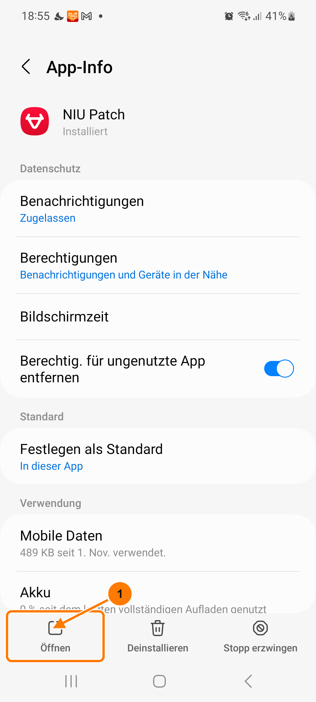
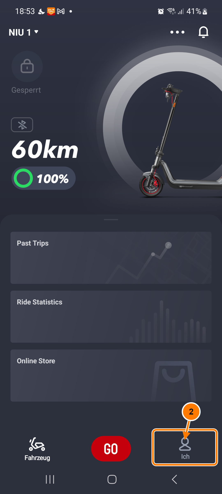
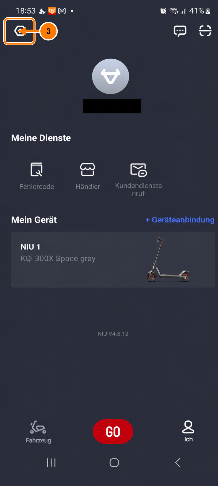
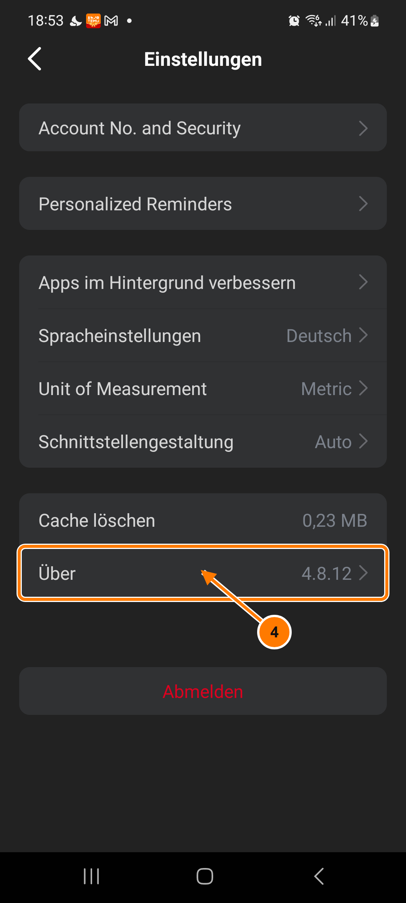
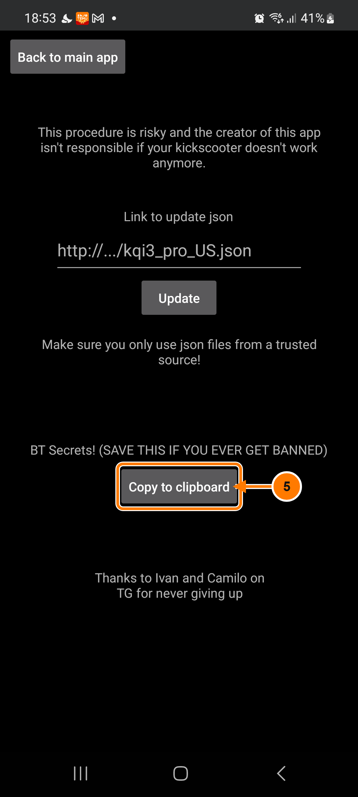
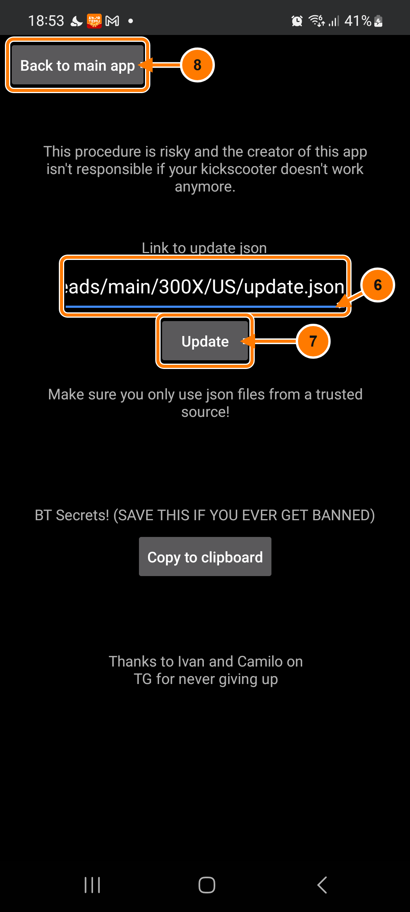
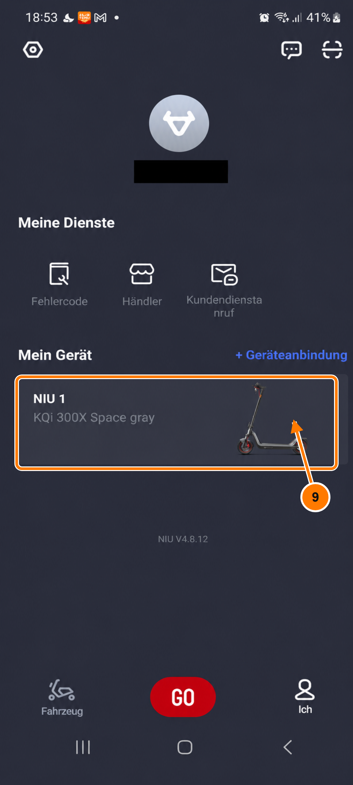
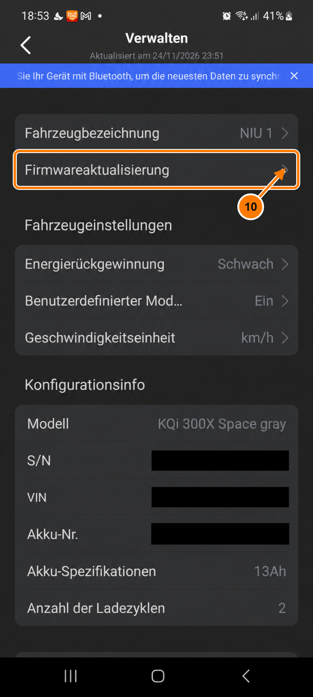
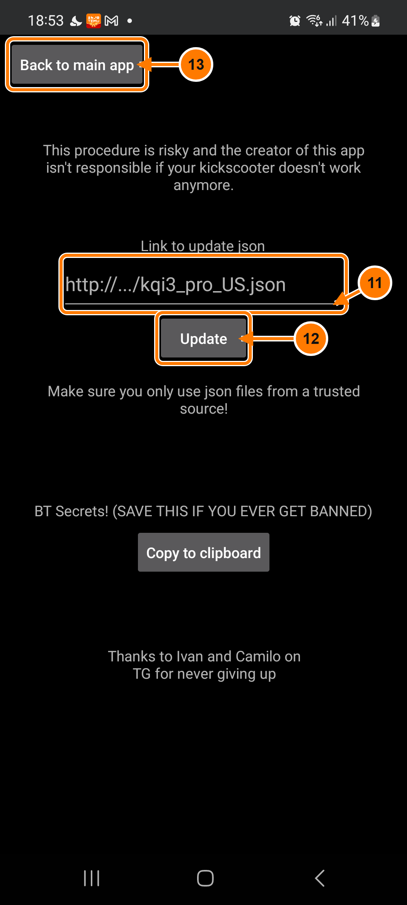

# NIU KQi 300X mit NIU Patch: Schritt für Schritt

Stand: **25. November 2026**. Für **NIU Patch 4.8.12 r1** aus diesem Repository und einen **NIU KQi 300X**.

**Die originale NIU-App bleibt installiert.** NIU Patch ist eine zweite App. Beide können auf demselben Handy installiert sein. Während der Verbindung zum Roller verwendest du jeweils nur eine davon.

Die Anleitung wurde mit öffentlich zugänglichen Anleitungen, den APK-Bedienelementen und dem Update-Code abgeglichen. Die Bilder wurden mit dem veröffentlichten Release auf einem Samsung SM-N981B mit Android 13 aufgenommen. Anmeldung und die hier gezeigten Menüs wurden am Handy geprüft; der Roller war bei den Aufnahmen nicht erreichbar. Ein vollständiger Flash wurde **nicht am Fahrzeug durchgespielt**. Die [Quellenprüfung](niu-patch-quellen.md) erklärt die Nachweise und offenen Punkte. Eine unbekannte Hardware- oder Firmwarevariante wird durch diese Anleitung nicht automatisch kompatibel.

## So liest du die Bilder

**Orange Rahmen markieren das Bedienelement. Die Pfeilspitze zeigt eine Stelle, auf die du tippen kannst. Die Zahl steht für die im Bildtext erklärte Aktion.** Die Zahlen 1 bis 13 begleiten den Ablauf. Einstellungen (**3**) und Fahrzeugauswahl (**9**) haben jeweils ein eigenes Bild an der passenden Stelle im Ablauf.

Die Aufnahmen zeigen Deutsch mit einigen englischen Beschriftungen und dunklem Design. Dein Handy kann anders aussehen. Die Android-App-Info ist zusätzlich als Installationskontrolle abgebildet. Profil und Fahrzeugverwaltung wurden zur Anonymisierung mit Bildbearbeitung verändert; diese zwei Bilder sind nicht pixelidentisch mit den Rohaufnahmen. Die markierten Bedienelemente wurden mit den echten Ansichten abgeglichen. Die übrigen Quellaufnahmen blieben unverändert. Rahmen, Pfeile und Zahlen wurden als separate SVG-Elemente ergänzt; für die Anzeige hier wurden daraus PNG-Bilder gerendert. [Bildherkunft und Bearbeitung](assets/niu-patch/README.md).

**Es gibt hier kein Bild eines angebotenen Updates, einer laufenden Übertragung oder einer Erfolgsmeldung:** Ohne Bluetooth-Verbindung lässt sich diese Ansicht auf dem vorhandenen Handy nicht erreichen. Die folgenden Bilder sind deshalb kein Beleg für einen erfolgreichen Flash.

## Zuerst verstehen: Was passiert?

Du führst drei getrennte Vorgänge aus:

| Vorgang | Was sich ändert | Wird dabei schon der Roller beschrieben? |
|---|---|---|
| NIU Patch installieren | Eine zusätzliche App kommt aufs Android-Handy. | Nein. |
| Eine `update.json` eintragen und dort **Update** drücken | Die App speichert die Adresse der gewünschten Update-Beschreibung. | Nein. |
| In der Fahrzeug-Firmwareaktualisierung **Jetzt aktualisieren** wählen und eine gegebenenfalls folgende Bestätigung annehmen | Die App lädt die Firmware und überträgt sie per Bluetooth zum Motorcontroller. | **Hier beginnt der eigentliche Update-Vorgang.** |

**FOC** ist die Bezeichnung des Motorcontrollers. **APK** ist die Android-Installationsdatei. **JSON** ist hier eine kleine Beschreibung mit Download-Adresse, Version und Prüfsumme. **BIN** ist die eigentliche Firmwaredatei; deren Adresse gehört nicht ins Eingabefeld für die JSON.

## 1. Vorbereitung

1. Lies am Typenschild bzw. in deinen Fahrzeugunterlagen nach, dass dein Roller wirklich **KQi 300X** ist. Diese Anleitung nicht für einen **300P, 300S, KQi2 oder KQi3** verwenden. Auch ein ersetzter Controller kann eine andere Ausgangslage bedeuten.
2. Benutze ein **Android-Handy mit Bluetooth und Internetzugang**. Auf einem iPhone lässt sich diese APK nicht installieren. Eine USB-Verbindung zum Computer ist für diesen Vorgang nicht erforderlich.
3. Stelle sicher, dass du dich mit dem NIU-Konto anmelden kannst, an das der Roller bereits gebunden ist. Halte Passwort bzw. die benötigte Möglichkeit zum Empfang eines Anmeldecodes bereit. **Nicht den Roller aus dem Konto entfernen.**
4. Öffne die originale NIU-App. Kontrolliere dort Modell und Erreichbarkeit des Rollers. Falls er noch gar nicht eingerichtet wurde, schließe zuerst die reguläre Einrichtung gemäß NIU-Anweisungen ab. Ein Firmwareupdate auf Verdacht ist dafür nicht erforderlich.
5. Notiere oder fotografiere die aktuell angezeigten Firmwareversionen von Motorcontroller, Dashboard, Bluetooth und Akku. Ein Screenshot ist nur eine Dokumentation; er ist **keine Sicherung deiner installierten Firmware**.
6. Lade Roller und Handy ausreichend auf. Als vorsichtige Arbeitsvorgabe für diese Anleitung: **Roller mindestens 80 %, Handy mindestens 50 %**. Das sind Reserven für den Ablauf, keine nachgewiesenen Mindestgrenzen dieser App. Höhere Anforderungen einer angezeigten Update-Meldung gelten zusätzlich.
7. Stelle den Roller trocken und stabil ab. Trenne vor dem Update das Ladegerät vom Roller. Der Roller bleibt während der Übertragung stehen; niemand fährt damit oder betätigt Gas und Bremse.
8. Sorge für eine stabile Internetverbindung. WLAN ist grundsätzlich möglich. Mobile Daten sind eine Alternative, falls die Download-Adressen über dein WLAN nicht erreichbar sind. Schalte Bluetooth und, wenn von Android für die Gerätesuche verlangt, Standort ein.
9. Plane ungestörte Zeit ein. Das Handy bleibt während des Updates direkt beim Roller, mit eingeschaltetem Bildschirm. Als praktische Empfehlung: höchstens etwa einen Meter Abstand.

**Kontrolle:** Richtiges Modell, Zugang zum bestehenden Konto, aktuelle Versionen dokumentiert, ausreichende Akkureserven vorhanden.

## 2. NIU Patch installieren

1. Öffne auf dem Android-Handy den **[Download der NIU_Patch.apk](https://github.com/mojomedia1812/KQi-300-X-P-Firmware/releases/download/niu-patch-v4.8.12-r1/NIU_Patch.apk)**.
2. Warte, bis der Download vollständig abgeschlossen ist.
3. Öffne im Browser die Downloads oder die Android-App **Dateien / Eigene Dateien → Downloads**.
4. Tippe auf **NIU_Patch.apk**.
5. Wenn Android fragt, ob diese Quelle Apps installieren darf, öffne die angebotenen Einstellungen und erlaube die Installation für den gerade verwendeten Browser oder Dateimanager. Die genaue Android-Beschriftung unterscheidet sich je Hersteller. Kehre anschließend zur Installationsabfrage zurück.
6. Tippe auf **Installieren** und warte auf die Erfolgsmeldung. Sicherheitsprüfungen nicht pauschal deaktivieren. Wenn Android die Installation blockiert, zuerst die genaue Meldung lesen; siehe Fehlerhilfe unten.
7. Wenn du bisher **NIU Parallel** aus diesem Projekt installiert hattest, darf Android ein **Update** dieser App anbieten. Das ist beabsichtigt: dieselbe Paketkennung und derselbe Signaturschlüssel, neuer sichtbarer Name.
8. Öffne die zusätzliche App **NIU Patch**. Kontrolliere im Zweifel über **App-Symbol lange drücken → App-Info**, dass du die Patch-App geöffnet hast.

Die normale NIU-App heißt weiterhin NIU. Die Patch-App hat die Paketkennung `com.niu.lxckb9p`; die originale App `com.niu.manager`. **NIU Patch installiert sich neben die originale App.** Wenn eine Installation stattdessen die originale NIU-App ersetzen soll, brich sie ab und überprüfe die heruntergeladene Datei.

Dateigröße dieses Releases: **72.602.525 Byte**. SHA-256:

```text
c2fcef9bd1d2b23cf47e9213cefc907b760f94266b49c39d3a3b574aa32471b2
```

**Kontrolle:** Auf dem Handy gibt es NIU und NIU Patch. Die Original-App wurde nicht deinstalliert.



**Bild 1 — Installierte App kontrollieren und öffnen.** Oben muss **NIU Patch** stehen. **1:** unten links **Öffnen** antippen. Die benachbarten Schaltflächen **Deinstallieren** und **Stopp erzwingen** gehören nicht zu diesem Schritt. Diese Samsung-Ansicht erreichst du über **App-Symbol lange drücken → App-Info**; auf anderen Android-Geräten sieht sie anders aus.

## 3. Anmelden und die Verbindung prüfen

1. Schließe die originale NIU-App. Um eine weiterlaufende Verbindung sicher zu beenden: **NIU-Symbol lange drücken → App-Info → Beenden erzwingen / Stopp erzwingen**. Das löscht keine App-Daten.
2. Schließe gegebenenfalls auch eine auf einem anderen Handy aktive Verbindung zum Roller.
3. Schalte den Roller ein.
4. Öffne **NIU Patch**.
5. Melde dich mit **demselben bestehenden NIU-Konto** an, an das dein Roller gebunden ist. Eine neue Installation übernimmt die Anmeldung der Original-App nicht.
6. Erlaube die angefragten Berechtigungen für die Bluetooth-Suche. Je nach Android-Version heißt die Freigabe **Geräte in der Nähe**, **Bluetooth** oder **Standort**. Manche ältere Apps benötigen auch eingeschalteten Standort für den Suchvorgang.
7. Wähle deinen vorhandenen Roller aus. Ist er nicht aufgeführt, überprüfe Konto und Anmelderegion. **Nicht als ersten Versuch entbinden oder ein neues Konto anlegen.**
8. Stelle die Verbindung innerhalb von NIU Patch her. Keine zusätzliche manuelle Kopplung in den Android-Bluetooth-Einstellungen erzwingen, solange die App sie nicht verlangt. Folge einer gegebenenfalls ausdrücklich angezeigten Bestätigung am Roller.
9. Prüfe, ob die App eine aktuelle Bluetooth-Verbindung anzeigt und Fahrzeugdaten lesen kann. Ein gespeichertes Rollerbild oder eine alte Akkuanzeige allein beweist keine aktive Verbindung.

**Kontrolle:** NIU Patch ist angemeldet, der richtige Roller ist ausgewählt, Bluetooth ist verbunden. Bei einer Fehlermeldung hier anhalten und zuerst die Verbindung klären.



**Bild 2 — Zum Profil wechseln.** **2:** unten rechts auf **Ich** tippen. Die Aufnahme entstand ohne Bluetooth-Verbindung: das durchgestrichene Bluetooth-Symbol und die gespeicherten Akku-/Reichweitenwerte sind **keine** Bestätigung einer aktuellen Verbindung.

## 4. Bluetooth-Schlüssel sichern

Diese Sicherung ist besonders vor einem späteren Löschen der Patch-App-Daten wichtig. Sie ersetzt weder dein NIU-Konto noch eine Firmware-Sicherung. Eine Wiederherstellung nach einer Kontosperre wurde mit diesem Release nicht geprüft.

1. Öffne in **NIU Patch** den Profilbereich unten: je nach Sprache **Ich / Me / Account**.
2. Öffne dort das **Zahnrad / Einstellungen**. In den verbreiteten Anleitungen befindet es sich oben links; orientiere dich am Symbol und an der Beschriftung.
3. Tippe auf **Über**; bei Englisch **About**.
4. Es soll die zusätzliche Manual-Update-Seite erscheinen. Du erkennst sie an **Link to update json**, **Update**, **Copy to clipboard** und **Back to main app**. Ihr interner Titel lautet **Niu Manual Update**; auf dem aufgenommenen Handy wird dieser Titel nicht als Überschrift eingeblendet. Die zusätzlichen Bedienelemente sind Englisch.
5. Unter der Überschrift **BT Secrets!** tippe auf **Copy to clipboard**.
6. Öffne eine private, dauerhaft gespeicherte Notiz, vorzugsweise im Passwortmanager, und füge den Inhalt ein. Schreibe dazu, zu welchem Roller und Datum er gehört.
7. Kontrolliere, dass tatsächlich Inhalt eingefügt wurde. Eine Meldung **bt secrets not set** bedeutet: Es wurde **keine** Schlüsselsicherung erstellt. In diesem Fall zurück in die App, Anmeldung und Verbindung prüfen und anschließend noch einmal versuchen.
8. Veröffentliche diese Daten nicht in GitHub-Issues, Screenshots oder öffentlichen Chats.
9. Kehre zu **NIU Patch → Einstellungen → Über** zurück.

**Kontrolle:** Die Schlüsseldaten sind außerhalb der Zwischenablage dauerhaft gespeichert. Wenn die Sicherung trotz funktionierender Verbindung nicht gelingt, ist die Ursache offen; insbesondere keine App-Daten löschen, solange du auf diese lokale Sicherung angewiesen bist.



**Bild 3 — Einstellungen finden.** **3:** oben links auf das sechseckige Einstellungssymbol tippen. Der Kontoname wurde anonymisiert.



**Bild 4 — Zusatzmenü öffnen.** **4:** auf die gesamte Zeile **Über** neben **4.8.12** tippen. Die darüberliegende Zeile **Cache löschen** und **Abmelden** weiter unten nicht betätigen.



**Bild 5 — Schlüsselsicherung beginnen.** **5:** **Copy to clipboard** unter **BT Secrets!** antippen. Danach selbst in eine private, dauerhaft gespeicherte Notiz einfügen und den Inhalt prüfen. Das Foto zeigt nur den Knopf; es wurden für die Veröffentlichung keine Bluetooth-Schlüssel ausgelesen oder abgebildet. Der graue KQi3-Beispieltext im Eingabefeld ist ein Platzhalter und keine für den 300X ausgewählte Datei.

## 5. Gewünschte Region auswählen

Wähle **genau eine** Region. Du gibst im nächsten Abschnitt nur deren vollständige JSON-Adresse ein.

| Auswahl | Erwartete Größenordnung | Zielversion im Update-Angebot | Firmwaredatei |
|---|---|---|---|
| DE | etwa **21 km/h**, vom Nutzer berichtet | `KBE38D05` | `KBE38M02.bin` |
| EU | nominell **25 km/h**; hier kein unabhängiger Fahrtest | `KBE01D03` | `KBE01M02.bin` |
| US | etwa **38 km/h**, vom Nutzer berichtet | `KBE13D03` | `KBE13M02.bin` |

Die [Analyse der Begrenzungen](speed-limits.md) und der [EU-Vergleich](eu-speed-limits.md) unterscheiden nominelle Werte, interne Telemetrie und gemessene Fahrgeschwindigkeit. Eine konkrete GPS-Geschwindigkeit kann diese Anleitung nicht garantieren. Zusätzliche Funktionen wie Tempomat, Zero-Start und Halo-Licht sind mit diesen Dateien nicht vollständig verifiziert.

**US – diesen gesamten Text kopieren:**

```text
https://github.com/mojomedia1812/KQi-300-X-P-Firmware/raw/refs/heads/main/300X/US/update.json
```

**EU – diesen gesamten Text kopieren:**

```text
https://github.com/mojomedia1812/KQi-300-X-P-Firmware/raw/refs/heads/main/300X/EU/update.json
```

**DE – diesen gesamten Text kopieren:**

```text
https://github.com/mojomedia1812/KQi-300-X-P-Firmware/raw/refs/heads/main/300X/DE/update.json
```

Die Zielversion enthält **D**, die BIN-Datei **M**. Diese unterschiedlichen Kennungen sind im Bestand vorhanden und kein Anlass, Dateien umzubenennen oder Versionsangaben zu erfinden.

## 6. Den Update-Link in NIU Patch speichern

1. Kopiere die vollständige Adresse der gewählten Region aus Abschnitt 5. Wenn du zuvor die Bluetooth-Schlüssel kopiert hast, enthält deine Zwischenablage sonst möglicherweise noch diese Schlüssel.
2. Öffne **NIU Patch → Ich / Me / Account → Zahnrad / Einstellungen → Über**.
3. Kontrolliere, dass die zusätzliche Seite mit **Link to update json** und den englischen Knöpfen geöffnet ist. Die Überschrift **Niu Manual Update** muss auf deinem Handy nicht sichtbar sein.
4. Tippe in das Eingabefeld direkt unter **Link to update json**.
5. Falls schon Text darin steht: lange auf den Text drücken, **Alles auswählen**, anschließend **Einfügen**. Das genaue Einfüge-Menü hängt von deiner Tastatur ab.
6. Vergleiche den eingefügten Text mit deiner Auswahl: Er beginnt mit `https://github.com/mojomedia1812/`, enthält `300X/US/`, `300X/EU/` oder `300X/DE/` und endet mit **`update.json`**. Keine Anführungszeichen, Leerzeichen oder zusätzliche Zeile mitkopieren. Nicht den Inhalt der JSON-Datei einfügen.
7. Falls die Bildschirmtastatur den Knopf verdeckt, blende nur die Tastatur aus. Auf Android genügt dafür normalerweise die Zurück-Geste bzw. die Taste zum Verbergen der Tastatur.
8. Tippe **einmal auf Update** auf dieser Seite.
9. Achte sofort auf die kurz eingeblendete Textmeldung. Bei angenommener Eingabe zeigt sie die gespeicherte Adresse an. Ist die Meldung zu schnell verschwunden, darfst du mit korrekt gefülltem Feld noch einmal **Update** drücken.
10. Bei **You must provide a link to a json file** wurde kein gültiger Link gespeichert. Korrigiere das Feld und wiederhole Schritt 8.
11. Tippe auf **Back to main app**. Gehe zurück zur Fahrzeugansicht.

**Bis hier wurde noch keine Firmware auf den Roller geschrieben.** Die Link-Meldung bestätigt ausschließlich das Speichern, keine Erreichbarkeit und keine Kompatibilität. Die App prüft an dieser Stelle nur, ob die Eingabe nicht leer ist und `.json` enthält.

**Besonderheit:** Beim erneuten Öffnen dieser Seite wird der gespeicherte Link nicht automatisch in das Eingabefeld geladen. Ein leeres Feld bedeutet deshalb nicht, dass die Einstellung verloren ist. **Leeres Feld + Update** entfernt dagegen bewusst die manuelle Einstellung; das benötigst du erst nach Abschluss oder bei der Fehlerhilfe.



**Bild 6 — Link eintragen und speichern: 6 → 7 → 8.** **6:** die vollständige JSON-Adresse deiner gewählten Region ins Feld einfügen. **7:** auf **Update** tippen und die kurz eingeblendete Adresse prüfen. **8:** danach **Back to main app** antippen. Im Foto ist die US-Adresse nur als Eingabebeispiel eingetragen; sie wurde für diese Aufnahme **nicht gespeichert**. Das schmale Feld zeigt nur das Ende der langen Adresse. Du musst trotzdem den vollständigen Link kopieren, nicht nur den sichtbaren Ausschnitt. EU und DE verwenden dasselbe Eingabefeld.

## 7. Das angebotene Firmwareupdate prüfen

1. Kontrolliere erneut: Roller eingeschaltet, NIU Patch per Bluetooth verbunden, originale NIU-App geschlossen.
2. Öffne **Ich → Mein Gerät** und tippe auf die Karte deines bereits gebundenen KQi 300X (**Markierung 9 in Bild 7 unten**). Dieser Weg wurde am Handy geprüft und führt zur Seite **Verwalten**. Je Ansicht ist außerdem ein Einstieg über das Fahrzeugmenü, häufig die drei Punkte, möglich.
3. Auf **Verwalten** tippe auf **Firmwareaktualisierung**; bei Englisch **Firmware Upgrade**.
4. Warte auf die Update-Prüfung. Falls du diese Seite schon vor dem Eintragen der JSON geöffnet hattest, verlasse sie und öffne sie erneut, damit eine neue Prüfung erfolgt.
5. Kontrolliere das **neu angebotene Update**: Es soll nur den Motorcontroller betreffen. Die sichtbare Komponentenbezeichnung kann **Motor Controller** lauten; in den Update-Daten heißt er **FOC**. Verlange deshalb nicht zwingend den wörtlichen Text FOC auf dem Bildschirm.
6. Vergleiche die angebotene Zielversion mit Abschnitt 5: US `KBE13D03`, EU `KBE01D03`, DE `KBE38D05`.
7. Bereits installierte Versionen anderer Komponenten können ebenfalls aufgelistet sein. Das ist nicht dasselbe wie ein neues Update für diese Komponenten. Falls zusätzlich **Akku/BMS, Dashboard/DB oder Bluetooth/ECU_BT neu aktualisiert werden sollen**, starte nicht; überprüfe App, Link und Angebot.
8. Falls nur **Dies ist die neueste Firmware / Sie verwenden schon die neueste Fassung** erscheint, gehe zur Fehlerhilfe. Das ist kein Beweis, dass die gewählte Region installiert wurde.

**Kontrolle vor dem Start:** KQi 300X, gewünschte Region, richtige Zielversion und ausschließlich ein neues Motorcontroller-Update. Stimmen diese Angaben nicht überein oder sind sie nicht erkennbar, hier anhalten.



**Bild 7 — Vorhandenen Roller auswählen.** **9:** unter **Mein Gerät** auf die Karte deines KQi 300X tippen. **+ Geräteanbindung** nicht antippen; der Roller ist bereits im Konto vorhanden. Der Kontoname wurde anonymisiert.



**Bild 8 — Firmwareprüfung öffnen.** **10:** die Zeile **Firmwareaktualisierung** antippen. Das ist der Einstieg zur Prüfung; es ist noch nicht der spätere Knopf **Jetzt aktualisieren**. Die Aufnahme zeigt ausdrücklich den Zustand **ohne Bluetooth-Verbindung**. In diesem Zustand erschien beim Antippen nur die Aufforderung, das Gerät mit Bluetooth zu verbinden und es erneut zu versuchen. Erst mit erreichbarem Roller weiterarbeiten. Seriennummer, VIN und Akkunummer wurden anonymisiert.

## 8. Die Übertragung starten und abwarten

1. Lies alle Hinweise der App. Wenn sie eine nicht erfüllte Bedingung meldet, erfülle sie vor dem Start.
2. Tippe auf der Seite **Firmwareaktualisierung** auf **Jetzt aktualisieren / Update now**.
3. Falls ein zusätzlicher Bestätigungsdialog erscheint, prüfe ihn und bestätige erst dann. Ab dem Start des Update-Ablaufs musst du von einer möglichen Übertragung ausgehen.
4. Die App kann zuerst einen Download und anschließend das Schreiben der Firmware anzeigen. **„Heruntergeladen“ allein ist noch kein erfolgreiches Fahrzeugupdate.**
5. Lass NIU Patch im Vordergrund auf dieser Seite. Bildschirm nicht sperren, nicht zur Original-App wechseln, Bluetooth und Internet nicht abschalten und keine App-Daten löschen.
6. Bleibe mit dem Handy direkt beim Roller. Betätige währenddessen keine Fahrzeugbedienelemente und schalte den Roller nicht von Hand aus. Ein von der App bzw. dem Controller ausgelöster Neustart ist davon zu unterscheiden.
7. Warte auf die ausdrückliche Erfolgsmeldung, beispielsweise **Firmware-Upgrade erfolgreich**. Die App enthält auch die Meldung **Firmware nicht aktualisiert** für einen Fehlschlag. Ein voller Fortschrittsbalken allein ersetzt die Erfolgsmeldung nicht.
8. Folge einer anschließend ausdrücklich angezeigten Aufforderung zum Neustart oder Wiederverbinden. Keine eigene erzwungene Neustartfolge während einer noch laufenden Übertragung durchführen.

Eine feste Übertragungsdauer wurde für diese APK am KQi 300X hier nicht gemessen. Die App zeigt eine Schätzung an. Es gibt deshalb in dieser Anleitung keine erfundene Regel wie „nach fünf Minuten ausschalten“.

## 9. Nach dem Update überprüfen und die manuelle Quelle entfernen

1. Warte, bis die App den Vorgang beendet hat, und verbinde dich gegebenenfalls erneut.
2. Öffne die Versionsübersicht unter **Verwalten → Firmwareaktualisierung** erneut und notiere die angezeigte Motorcontroller-Version. Vergleiche mit vorher und mit deiner Zielregion. Eine noch zwischengespeicherte Anzeige ist kein unabhängiger Auslesebeweis.
3. Entferne jetzt die manuelle Update-Einstellung: **Ich / Me / Account → Einstellungen → Über → Niu Manual Update** öffnen, das Link-Feld **vollständig leeren** und **Update** drücken.
4. Die Meldung **You must provide a link to a json file** ist bei diesem bewussten Entfernen **erwartet**. Der APK-Code löscht bei leerer Eingabe den gespeicherten Link. Beim erstmaligen Eintragen wäre dieselbe Meldung ein Fehler.
5. Tippe **Back to main app** und schließe NIU Patch. Das Entfernen des Links setzt die Roller-Firmware **nicht** zurück. Es beendet die Verwendung der manuell gewählten Update-Quelle in der App.
6. Für die normale Verwendung darfst du nun die originale NIU-App öffnen und wieder verbinden. Ein in dieser App angebotenes **Fahrzeug-Firmwareupdate** ist eine weitere Änderung am Roller; prüfe es, bevor du es installierst. Ein Android-Update der Original-App ist davon unabhängig und ersetzt die parallel installierte Patch-App nicht.
7. Prüfe im Stand zunächst Fehleranzeige, Bremsen und Licht. Stelle einen benutzerdefinierten Geschwindigkeitswert, falls vorhanden, zunächst niedrig ein. Ein Wechsel auf US-Firmware ist kein Grund, die erste Fahrt sofort mit maximaler Geschwindigkeit zu beginnen.
8. Wenn du später die Geschwindigkeit prüfst, verwende einen geeigneten abgesperrten Bereich ohne öffentlichen Verkehr. Beachte Fahrmodus und eventuell eingestelltes Custom-Limit. **32 km/h und 38 km/h sind unterschiedliche Werte; eine ältere App-Anzeige allein bestimmt nicht die Grenze im Motorcontroller.**

**Abschlusskontrolle:** Erfolgsmeldung erhalten, Versionsanzeige dokumentiert, manuelle Quelle entfernt und normale Verbindung wiederhergestellt. Bei Warnungen oder Fehlverhalten keine Probefahrt durchführen.



**Bild 9 — Erst nach Abschluss die manuelle Quelle entfernen: 11 → 12 → 13.** **11:** ins Feld tippen, vorhandenen Text vollständig auswählen und löschen. Ein grauer Beispieltext wie `http://.../kqi3_pro_US.json` ist nur der Platzhalter eines leeren Felds. **12:** **Update** drücken. Die Meldung **You must provide a link to a json file** ist bei diesem bewussten Entfernen erwartet. **13:** **Back to main app** antippen. Diese Bildfolge beschreibt keine Rückkehr zur DE-Firmware.

## 10. Fehlerhilfe: Erst lesen, dann handeln

### Die APK lässt sich nicht installieren

- Prüfe, ob es wirklich die APK aus dem verlinkten Release und ein Android-Gerät ist.
- Lade die Datei bei unvollständigem Download erneut herunter. Prüfe verfügbaren Telefonspeicher und die Erlaubnis für den verwendeten Dateimanager/Browser.
- Bei **App wurde nicht installiert**, einem Paketkonflikt oder einer Signaturmeldung: genaue Meldung notieren. Eine andere bereits installierte App mit `com.niu.lxckb9p`, aber anderem Schlüssel lässt sich nicht durch dieses Release aktualisieren. Nicht vorschnell die Original-App oder eine vorhandene Patch-App mit wichtigen lokalen Daten löschen.
- Meldet Android eine Richtlinien- oder Sicherheitsblockade, nicht pauschal Geräteschutz abschalten. Die Paket- und Signaturdaten stehen in den [Release-Details](niu-patch.md).

### Unter Über erscheint kein Niu Manual Update

1. Kontrolliere, dass **NIU Patch** geöffnet ist.
2. Öffne die **App-Einstellungen im Profil**, nicht die allgemeinen Android-Einstellungen und nicht die Fahrzeug-Firmwareseite.
3. Öffne dort **Über / About**. Die Original-App besitzt diese Zusatzseite nicht.

### Die Anmeldung in NIU Patch scheitert

1. Prüfe Internet, Kontodaten, Anmelderegion und gegebenenfalls den empfangenen Bestätigungscode. Verwende das bestehende Konto des Rollers.
2. Falls du eine bisherige NIU Parallel/Patch mit schon gespeicherter manueller Quelle verwendest und die Einstellungsseite noch erreichst: Link-Feld unter **Einstellungen → Über** vollständig leeren und **Update** drücken. Danach die Anmeldung erneut versuchen. Die manuelle Quelle beeinflusst auch einen HTTP-Helfer der App; dies ist eine begründete Prüfung, keine garantierte Lösung für jeden Anmeldefehler.
3. Wenn die Original-App funktioniert, die Patch-App aber nicht, dokumentiere deren genaue Meldung. Die Patch-App basiert auf einer älteren NIU-Version; aktuelle Serverkompatibilität wurde hier nicht nachgewiesen. Nicht als vermeintliche Reparatur das Konto löschen oder den Roller entbinden.

### Bluetooth verbindet sich nicht

1. Keine laufende Firmwareübertragung unterbrechen. Diese Schritte gelten vor dem Start oder nach einem ausdrücklich beendeten Fehlversuch.
2. Original-App sowie andere aktive Handy-Verbindungen schließen.
3. Roller einschalten, Handy danebenlegen, Bluetooth einschalten und Patch-App-Berechtigungen überprüfen.
4. Falls Android es für die Suche verlangt, Standort einschalten und die entsprechende Berechtigung erteilen.
5. NIU Patch erneut öffnen und den bereits gebundenen Roller auswählen. Nur wenn kein Update läuft, darfst du für einen normalen neuen Verbindungsversuch App bzw. Roller neu starten.
6. Bei weiterhin fehlender Verbindung anhalten. Nicht als Standardlösung Konto löschen, Fahrzeug entbinden oder fremde Firmware ausprobieren.

### Der Link wird bestätigt, aber es erscheint kein Update

Arbeite diese Reihenfolge ab. Vor dem Datenlöschen nicht direkt zu Punkt 7 springen.

1. Prüfe, ob du **NIU Patch** verwendest und die Bluetooth-Verbindung aktiv ist.
2. Vergleiche die vollständige Adresse mit Abschnitt 5. Es muss die **Raw-JSON-Adresse** sein, keine GitHub-`blob`-Seite und keine BIN-Adresse.
3. Öffne dieselbe Adresse testweise im Handy-Browser. Erwartet wird JSON-Text bzw. eine JSON-Datei mit `data`, `items`, `devicetype` und `FOC`, keine 404-Seite und keine GitHub-Dateiansicht. Manche Browser laden die JSON herunter; öffne sie dann als Text. Veröffentliche dabei keine persönlichen Fahrzeugdaten.
4. Füge den Link in der Patch-App erneut ein, drücke **Update**, prüfe die eingeblendete Adresse und öffne anschließend die Fahrzeug-Firmwareaktualisierung neu.
5. Wenn die Adresse nicht erreichbar ist, prüfe deine Internetverbindung. Ein Versuch mit mobilen Daten statt WLAN ist eine mögliche Verbindungsprüfung, kein nachgewiesener Schutzmechanismus gegen eine Firmware-Sperre. Netzwerkwechsel nur vor einer Übertragung.
6. Prüfe, ob genau diese Zielversion bereits installiert ist. Falls ja, ist ein erneuter Flash normalerweise unnötig. Eine Meldung „neueste Firmware“ allein beweist das aber nicht.
7. Erst wenn du diese Version schon einmal **erfolgreich mit dieser App** eingespielt hast, kommt ein gespeicherter Versionsstand als Ursache infrage: Der Code kann ein Angebot ausblenden, dessen Version mit dem lokalen Eintrag für denselben Roller und dasselbe Bauteil übereinstimmt. Die App-Daten kannst du als letzten Versuch gemäß dem folgenden Unterabschnitt zurücksetzen.
8. Wenn das Problem schon beim ersten Versuch besteht oder nach den Prüfungen bleibt: Ausgangsversionen, Android-Version, Patch-Release, gewählte Region und genaue Meldung dokumentieren. Bei manchen Kombinationen wird kein Update angeboten; eine universell funktionierende Umgehung ist hier nicht nachgewiesen. **Keine Fantasie-Versionsnummern oder Zeitstempel eintragen.**

### Letzter Versuch bei bekanntem Versionsspeicher: Nur Patch-App-Daten löschen

**Dabei gehen Anmeldung, gespeicherter Link und lokale Daten von NIU Patch verloren.** Die getrennten lokalen Daten der Original-App werden dadurch nicht gelöscht. Dies ist kein Entbinden des Fahrzeugs vom Konto und kein Zurücksetzen der Roller-Firmware.

1. Vergewissere dich, dass kein Update läuft.
2. Sichere die Bluetooth-Schlüssel wie in Abschnitt 4. Prüfe die dauerhaft gespeicherte Kopie und deine Möglichkeit zur erneuten Anmeldung.
3. Öffne **Android-Einstellungen → Apps → NIU Patch → Speicher / Speicher und Cache**.
4. Kontrolliere nochmals den Namen **NIU Patch**.
5. Wähle **Daten löschen / Speicherinhalt löschen** und bestätige den Datenverlust. **Cache leeren allein** entfernt die gespeicherten Einstellungen nicht zuverlässig.
6. Starte NIU Patch, melde dich mit dem bisherigen Konto an und verbinde deinen vorhandenen Roller erneut.
7. Trage die gewünschte JSON-Adresse nach Abschnitt 6 neu ein; auch sie wurde gelöscht.
8. Prüfe das Update-Angebot erneut. Wenn es weiter fehlt, anhalten. Wiederholtes Datenlöschen löst keine unbekannte Inkompatibilität.

### Download oder Übertragung meldet einen Fehler

1. Lies und dokumentiere die genaue Fehlermeldung sowie den letzten sichtbaren Fortschritt. Unterscheide **Download fehlgeschlagen** von einem Fehler beim Schreiben auf den Roller.
2. Zeigt die App ausdrücklich einen beendeten Fehler und bietet Wiederverbinden/Wiederholen an, folge dieser Aufforderung mit stabiler Verbindung und ausreichenden Akkus. Vor einem erneuten Start das richtige FOC-Angebot kontrollieren.
3. Solange die App noch aktualisiert oder der Zustand unklar ist, nicht eigenmächtig Roller ausschalten, App beenden oder andere Firmware nachschieben. Eine feste sichere Wartefrist ist für diesen Fall hier nicht bekannt.
4. Ist der Roller danach nicht mehr erreichbar oder zeigt dauerhaft Fehler, keine blinden Flashversuche. Dokumentiere den Zustand und lasse die Wiederherstellung am konkreten Gerät klären.

### Zurück zur DE-Version

Die **DE-JSON** aus Abschnitt 5 ist der vorhandene Update-Einstieg für `KBE38D05`. Ein Rückwechsel wäre **ein neuer vollständiger Firmware-Flash** mit denselben Prüfungen und Risiken. Er ist für jede aktuelle Hardware-/Versionskombination nicht garantiert. Die APK löschen, den manuellen Link entfernen oder die Original-App öffnen setzt die Firmware nicht zurück. Ebenso ist das Einspielen dieser DE-Datei kein nachgewiesenes vollständiges Wiederherstellen aller werkseitigen oder zulassungsrelevanten Zustände.

## Quellen und Nachweise

[Abgleich der gefundenen Anleitungen und APK-Prüfung](niu-patch-quellen.md) · [APK und Signaturdetails](niu-patch.md) · [DE-/US-Begrenzung](speed-limits.md) · [EU-Vergleich](eu-speed-limits.md)
