# NIU KQi 300X mit NIU Patch 5.12.2: Schritt für Schritt

Stand: **25. November 2026**, Release **`niu-patch-v5.12.2-r1`**. Diese Anleitung gilt für die neue App **NIU Patch 5.12.2**, nicht für die frühere 4.8.12-Oberfläche.

> [!IMPORTANT]
> **NIU Patch bleibt parallel zur originalen NIU-App installiert.** Diese Version ersetzt eine bisherige **NIU Patch / NIU Parallel** aus diesem Projekt mit derselben Paketkennung und Signatur als Android-App-Update. Die bestehende Patch-App dafür **nicht vorher deinstallieren**.

> [!NOTE]
> **Am Handy geprüft, noch nicht am Roller geflasht:** Update von 4.8.12 auf 5.12.2 ohne Löschen der Appdaten, Start ohne erneute Anmeldung, Menü, US-JSON und BIN-Prüfsumme sowie eine vorbereitete FOC-Antwort im tatsächlichen NIU-Parser. Kein Roller war verfügbar; Bluetooth-Verbindung, Update-Angebot am Fahrzeug und Firmwareübertragung sind mit diesem Release **nicht getestet**. Die Schritte am Roller beschreiben den vorgesehenen Ablauf, keinen nachgewiesenen erfolgreichen Flash.

Die [bisherige bebilderte Anleitung für 4.8.12](niu-patch-anleitung-4.8.12.md) bleibt als Archiv erhalten. Ihre englischen Knöpfe **Update**, **Copy to clipboard** und **Back to main app** gehören zur alten Version. In 5.12.2 heißen die relevanten Knöpfe **Quelle prüfen und aktivieren**, **Manuelle Quelle deaktivieren** und **Zurück zur NIU-App**. Eine **BT-Secrets-Kopierfunktion ist in 5.12.2 nicht enthalten**.

## So liest du die aktuellen Bilder

Die folgenden **zwölf Abbildungen stammen aus der veröffentlichten NIU Patch 5.12.2 r1** auf einem Samsung SM-N981B mit Android 13. Die installierte APK wurde per SHA-256 mit dem Release abgeglichen. **Orange Rahmen und nummerierte Pfeile markieren genau eine Tippaktion pro Bild. Tippe auf die Pfeilspitze, nicht auf die Zahl am rechten Bildrand. Grüne Rahmen bedeuten: Status lesen, dort nicht tippen.** Die Aktionsnummern 1–10 sind Bildmarkierungen und keine Abschnittsnummern dieser Anleitung.

Profil und Fahrzeugverwaltung wurden zur Anonymisierung mit dem Bildwerkzeug bearbeitet; Kontoname, S/N und VIN sind geschwärzt. Diese zwei Quellen sind nicht pixelidentisch mit den Geräteaufnahmen. Die relevanten Texte und Tippbereiche wurden mit den echten Ansichten abgeglichen. Alle übrigen Quell-PNGs sind unveränderte Geräteaufnahmen. [Bildherkunft, Prüfsummen und Markierungskoordinaten](assets/niu-patch-5.12.2/README.md).

**US ist in den Bildern ein Eingabebeispiel, keine Empfehlung für jede Verwendung.** Für DE oder EU wählst du den entsprechenden benachbarten Regionsknopf. Die Quellenprüfung und der interne Test wurden für diese Aufnahmen tatsächlich ausgeführt; danach wurde die manuelle Quelle wieder deaktiviert. **Kein Firmwareupdate wurde auf den Roller übertragen.** Ohne Roller gibt es hier keine Bilder eines echten Update-Angebots, einer Übertragung oder einer Fahrzeug-Erfolgsmeldung.

## 1. Was die einzelnen Schritte bewirken

| Aktion | Wirkung | Schreibt sie bereits Firmware auf den Roller? |
|---|---|---|
| `NIU_Patch.apk` installieren | Installiert die App oder aktualisiert die bisherige NIU Patch. | Nein. |
| **DE**, **EU** oder **US** wählen | Trägt die JSON-Adresse ein und deaktiviert eine zuvor aktive manuelle Quelle. | Nein. |
| **Quelle prüfen und aktivieren** | Lädt und prüft JSON und BIN; aktiviert danach die vorbereitete FOC-Update-Antwort. | Nein. |
| **Interner Test – ohne Roller** | Prüft diese Antwort mit Testdaten und dem tatsächlichen NIU-Parser. | Nein. |
| In der Fahrzeug-Firmwareseite **Jetzt aktualisieren** und gegebenenfalls die anschließende Bestätigung wählen | Startet den eigentlichen Fahrzeug-Update-Ablauf. | **Ab hier ist mit einer Übertragung zu rechnen.** |
| **Manuelle Quelle deaktivieren** | Schaltet wieder auf die normale Firmwareprüfung um. | Nein; setzt auch keine Roller-Firmware zurück. |

**FOC** bezeichnet den Motorcontroller. **App-Update** und **Roller-Firmwareupdate** sind zwei verschiedene Vorgänge.

## 2. Die richtige APK herunterladen und installieren

Voraussetzung: **Android 8 oder neuer und ARM64**. Diese APK ist kein Installer für iPhones, x86-Geräte oder ausschließlich 32-Bit-Android.

1. Lade **[NIU_Patch.apk aus dem Release 5.12.2 r1](https://github.com/mojomedia1812/KQi-300-X-P-Firmware/releases/download/niu-patch-v5.12.2-r1/NIU_Patch.apk)** herunter. Öffne die heruntergeladene APK, keine BIN- oder JSON-Datei.
2. Lass die **originale NIU-App** installiert.
3. Ist die bisherige **NIU Patch / NIU Parallel** aus diesem Projekt installiert, lass auch sie installiert. Öffne die neue APK und wähle im Android-Dialog **Aktualisieren / Installieren**. Dieselbe Paketkennung `com.niu.lxckb9p`, derselbe Signaturschlüssel und der höhere Versionscode ermöglichen das Update.
4. Falls Android die Installation aus dem verwendeten Browser oder Dateimanager noch nicht erlaubt, folge der angezeigten Freigabe für genau diese Quelle und öffne die APK anschließend erneut.
5. Warte auf **App installiert** und öffne **NIU Patch**. Der sichtbare Name bleibt **NIU Patch**, ohne angehängte 5.
6. Bei einem normalen Update bleiben die bisherigen Android-Appdaten erhalten. Auf dem geprüften Handy blieb auch die Anmeldung bestehen. Falls die App erneut eine Anmeldung verlangt, verwende dein bestehendes NIU-Konto.
7. Kontrolliere später unter **Profil/Ich → Einstellungen → Über**, dass das neue Menü **NIU Patch** die Zeile **5.12.2 · Manuelle Firmwarequelle für KQi 300X** zeigt.

**Nur falls du die frühere separate Test-App „NIU Patch 5“ installiert hast:** Sie verwendet `com.niu.patchv5` und wird von dieser APK nicht automatisch ersetzt. Installiere zuerst die neue **NIU Patch**, prüfe Start und Anmeldung und entferne danach ausschließlich die zusätzliche Test-App **NIU Patch 5**. Deren eigene Anmeldung wird nicht zwischen Android-Paketen übertragen. Auf dem bereits geprüften Handy ist diese Bereinigung erfolgt.

Bei Signatur- oder Paketkonflikten keine vorhandene App mit wichtigen Daten vorschnell deinstallieren. Notiere die genaue Meldung und vergleiche die [Paket- und Signaturdaten](niu-patch.md).

SHA-256 der APK; zusätzlich liegen [SHA256SUMS.txt und der Prüfbericht im Release](https://github.com/mojomedia1812/KQi-300-X-P-Firmware/releases/tag/niu-patch-v5.12.2-r1):

```text
fee47a901ec2dbbee9817afbc964266bf218412caf0a2658c99c51bb1e114a2d
```

**Kontrolle:** Originale NIU und NIU Patch sind installiert; NIU Patch zeigt Version 5.12.2. Ein Android-App-Update hat noch keine Roller-Firmware geändert.

## 3. Konto und Verbindung vorbereiten

1. Öffne **NIU Patch**. Bei einer Neuinstallation musst du dich separat mit dem bestehenden Konto anmelden, an das der KQi 300X gebunden ist. Die Anmeldung der originalen NIU-App wird nicht übernommen.
2. Ist der Roller im Konto nicht aufgeführt, prüfe Konto und Anmelderegion. Nicht als Standardlösung entbinden oder ein neues Konto anlegen.
3. Bevor du den Roller verbindest, schließe die originale NIU-App und andere aktive Handy-Verbindungen zum Roller. Beide Apps dürfen installiert sein; verwende für die Fahrzeugverbindung jeweils eine.
4. Halte Handy und Roller ausreichend geladen, stelle eine stabile Internetverbindung her und bleibe mit dem Handy beim Roller. Erfülle zusätzlich alle von der App angezeigten Update-Voraussetzungen. Eine konkrete, mit diesem Release geprüfte Akku-Mindestgrenze liegt nicht vor.
5. Schalte den Roller und Bluetooth am Handy ein. Erlaube NIU Patch die angeforderten Bluetooth-/Geräte-in-der-Nähe-Berechtigungen; falls Android bei der Suche Standort verlangt, folge dem entsprechenden Hinweis.
6. Wähle den vorhandenen **KQi 300X** in NIU Patch und stelle die Verbindung innerhalb der App her. Erzwinge keine zusätzliche Kopplungsfolge, solange die App sie nicht verlangt.
7. Prüfe aktuelle Verbindung und lesbare Fahrzeugdaten. Ein gespeichertes Fahrzeugbild oder alte Akkuwerte belegen keine Verbindung.
8. Notiere die bisher angezeigte Motorcontroller-Version, bevor du etwas am Fahrzeug aktualisierst.

**Die Modellprüfung bleibt bei dir:** Die Injektion erkennt eine passende KBE-Firmwarefamilie in der OTA-Anfrage; das ist kein unabhängiger Nachweis des physischen Rollermodells. Dieses Projekt enthält 300X-Dateien, keine nachgewiesen kompatiblen 300P-Dateien.

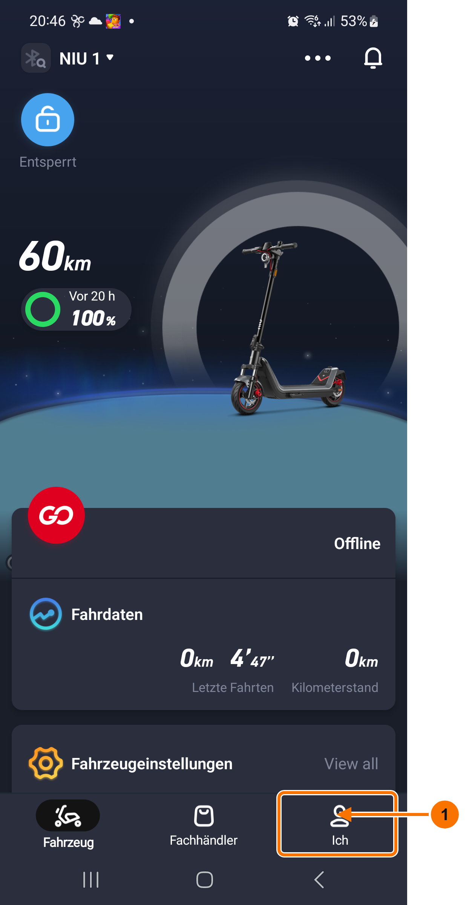

**Bild A — Profil öffnen, Aktion 1.** Unten rechts **Ich** antippen. Das Bild zeigt **Offline**; die gespeicherten Akku- und Reichweitenwerte bestätigen keine Bluetooth-Verbindung.

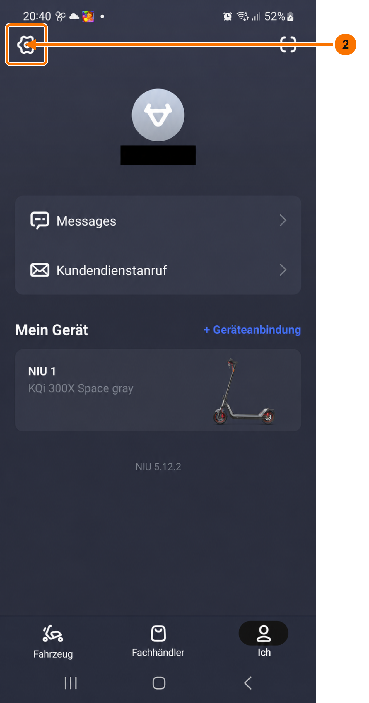

**Bild B — App-Einstellungen öffnen, Aktion 2.** Oben links auf das weiße **Einstellungssymbol** tippen. Dieses Bild markiert ausschließlich die Einstellungen. Der geschwärzte Kontoname und die Fahrzeugkarte gehören nicht zu dieser Aktion.

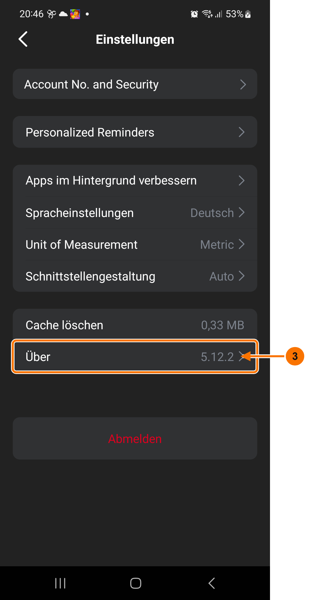

**Bild C — Zusatzmenü öffnen, Aktion 3.** Auf die Zeile **Über** neben **5.12.2** tippen. **Cache löschen** darüber und **Abmelden** darunter nicht betätigen.

## 4. Region auswählen und Quelle prüfen

Für das Prüfen der Quelle ist Internet erforderlich; der Roller muss dafür noch nicht verbunden sein.

1. Öffne **NIU Patch → Profil/Ich → Einstellungen → Über**. Am geprüften Handy und vom Nutzer wurde bestätigt, dass dort das zusätzliche Menü erscheint.
2. Kontrolliere die Überschrift **NIU Patch** und die Versionszeile **5.12.2**.
3. Wähle genau eine Region über **DE**, **EU** oder **US**. Der passende vollständige Link erscheint unter **Link zur update.json**.
4. Vergleiche Region und gewünschte Zielversion mit dieser Tabelle:

| Auswahl | FOC-Zielversion | BIN-Datei | Geschwindigkeitsangabe |
|---|---|---|---|
| DE | `KBE38D05` | `KBE38M02.bin` | etwa 21 km/h vom Nutzer berichtet |
| EU | `KBE01D03` | `KBE01M02.bin` | 25 km/h nominell; kein eigener Fahrtest |
| US | `KBE13D03` | `KBE13M02.bin` | etwa 38 km/h vom Nutzer berichtet |

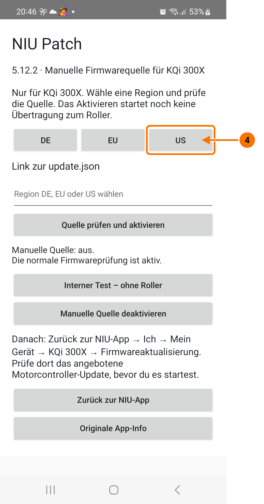

**Bild D — Region wählen, Aktion 4.** Im gezeigten Beispiel auf **US** tippen. Für DE oder EU stattdessen den entsprechend beschrifteten Knopf wählen. Hier ist die Quelle noch **aus**; der Regionsknopf allein aktiviert sie nicht.

5. Tippe **Quelle prüfen und aktivieren**.
6. Warte, bis die Prüfung beendet ist. Die App lädt die JSON und die BIN und vergleicht unter anderem FOC, Zielversion, URL, Dateigröße **29.696 Byte** und die hinterlegte MD5-Prüfsumme.
7. Fahre nur weiter, wenn **Aktiv: DE**, **Aktiv: EU** oder **Aktiv: US** mit der passenden Zielversion erscheint und der Status die geprüfte Quelle und BIN-Prüfsumme bestätigt.
8. Erscheint **Nicht aktiviert: …**, lies die konkrete Meldung und behebe den Fehler. Nach einer fehlgeschlagenen Prüfung ist die manuelle Quelle nicht aktiv.

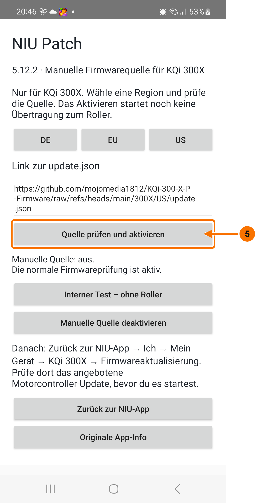

**Bild E — JSON und BIN prüfen, Aktion 5.** Die Adresse wurde durch die Regionswahl eingetragen. Auf **Quelle prüfen und aktivieren** tippen und die Prüfung abwarten. Im Foto ist vor diesem Tipp die manuelle Quelle weiterhin **aus**. Ein Fokus auf das Link-Feld oder ein weiterer Regionsklick ersetzt diesen Knopf nicht.

**Bis hier wurde keine Firmware auf den Roller übertragen.** Die App akzeptiert nur die vorgesehenen DE-/EU-/US-Quellen aus diesem Repository; eine beliebige fremde JSON lässt sich nicht freischalten. Eine neue Regionswahl oder eine Änderung am Link deaktiviert die vorherige Quelle. Danach musst du erneut **Quelle prüfen und aktivieren** wählen. Beim erneuten Öffnen des Menüs wird der Link einer aktiven Quelle angezeigt; der Status **Aktiv: …** ist die entscheidende Kontrolle.

Die [Firmwareanalyse](speed-limits.md) und der [EU-Vergleich](eu-speed-limits.md) unterscheiden nominelle Grenzen, Telemetrieskala und berichtete Fahrgeschwindigkeit. Eine bestimmte GPS-Geschwindigkeit, Tempomat, Zero-Start oder Halo-Licht sind durch die Quellenprüfung nicht garantiert.

## 5. Optional: ohne Roller testen

1. Lass die erfolgreich geprüfte Quelle aktiv.
2. Tippe **Interner Test – ohne Roller**.
3. Warte auf **Interner Test bestanden** und die richtige FOC-Zielversion.
4. Lies die Einschränkung in der Meldung: **Bluetooth-Verbindung und Übertragung zum Roller wurden nicht getestet.**

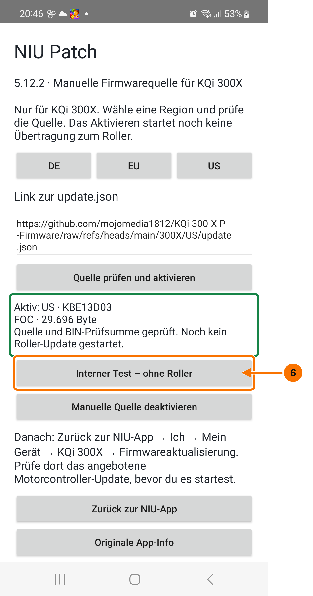

**Bild F — Aktive Quelle kontrollieren und optional testen, Aktion 6.** Im **grünen Rahmen** muss deine gewählte Region mit der passenden Zielversion stehen; hier **Aktiv: US · KBE13D03** und die bestätigte BIN-Prüfung. Für den optionalen Test auf **Interner Test – ohne Roller** an der orangefarbenen Pfeilspitze tippen. **Manuelle Quelle deaktivieren** direkt darunter ist eine andere Aktion.

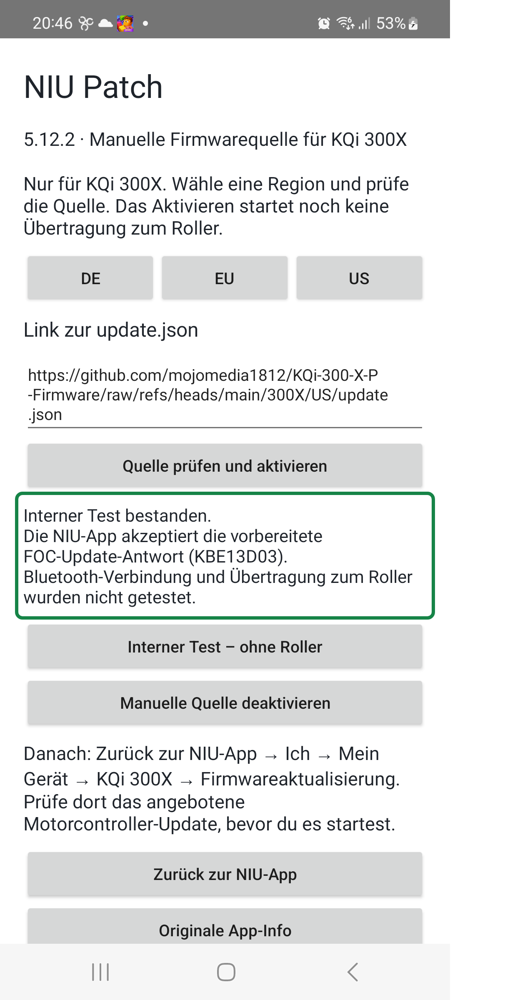

**Bild G — Testergebnis lesen, keine Tippaktion.** Der grüne Rahmen zeigt die tatsächlich am Handy erschienene Meldung **Interner Test bestanden**. Das bestätigt die vorbereitete Antwort im NIU-Parser; die Einschränkung zu Bluetooth und Übertragung gehört zur selben Meldung. Es ist keine Erfolgsmeldung eines Roller-Updates.

Der Test verwendet synthetische Anfragedaten und den echten JSON-Parser der NIU-App. Er sendet keinen Firmware-Flash und keine echte Kontoanfrage. Ein bestandener Test ersetzt die Kontrolle des tatsächlichen Update-Angebots am verbundenen KQi 300X nicht. Wenn du nur testen möchtest, wähle jetzt **Manuelle Quelle deaktivieren** und kontrolliere **Manuelle Quelle: aus.**

## 6. Das tatsächliche Update-Angebot prüfen

**Ab hier ist der passende, eingeschaltete und per Bluetooth verbundene Roller nötig. Dieser Teil wurde mit 5.12.2 nicht am Fahrzeug getestet.**

1. Kontrolliere, dass deine gewünschte Quelle aktiv ist, die originale NIU-App geschlossen ist und NIU Patch eine aktuelle Bluetooth-Verbindung hat.
2. Tippe **Zurück zur NIU-App**. Falls nötig etwas nach unten scrollen. Du landest gegebenenfalls zunächst wieder in den App-Einstellungen; dann mit dem Zurück-Pfeil oben links zum Profil zurückgehen.
3. Öffne **Profil/Ich → Mein Gerät → vorhandener KQi 300X → Verwalten → Firmwareaktualisierung**. Dieser Menüweg wurde jetzt auch mit 5.12.2 am Handy geprüft. Ohne erreichbaren Roller zeigte die App beim Antippen die Aufforderung, das Gerät per Bluetooth zu verbinden und es erneut zu versuchen; die eigentliche Update-Ansicht wurde damit nicht erreicht.
4. Warte auf die Firmwareprüfung. War diese Ansicht schon vorher geöffnet, verlasse sie und öffne sie erneut, damit eine neue Abfrage erfolgt.
5. Prüfe das **neu angebotene** Update: ausschließlich Motorcontroller / **Motor Controller**, intern **FOC**, und die richtige Zielversion aus Abschnitt 4.
6. Bereits installierte andere Komponenten können in einer Versionsübersicht auftauchen. Sollen zusätzlich **Akku/BMS, Dashboard/DB oder Bluetooth/ECU_BT neu aktualisiert werden**, starte nicht; das entspricht nicht dem FOC-Angebot dieses Projekts.
7. Erscheint kein Angebot oder nur **neueste Firmware**, ist das kein Beweis einer erfolgreich installierten Zielregion. Folge der Fehlerhilfe unten.
8. Stimmen Modell, Region, Zielversion oder Komponente nicht überein oder lassen sie sich nicht sicher prüfen, halte hier an.

Eine aktivierte Quelle kann bei einer passenden OTA-Abfrage ein Angebot liefern. Ob die konkrete Fahrzeug-/Firmwarekombination dieses Angebot annimmt und erfolgreich schreibt, ist noch offen.

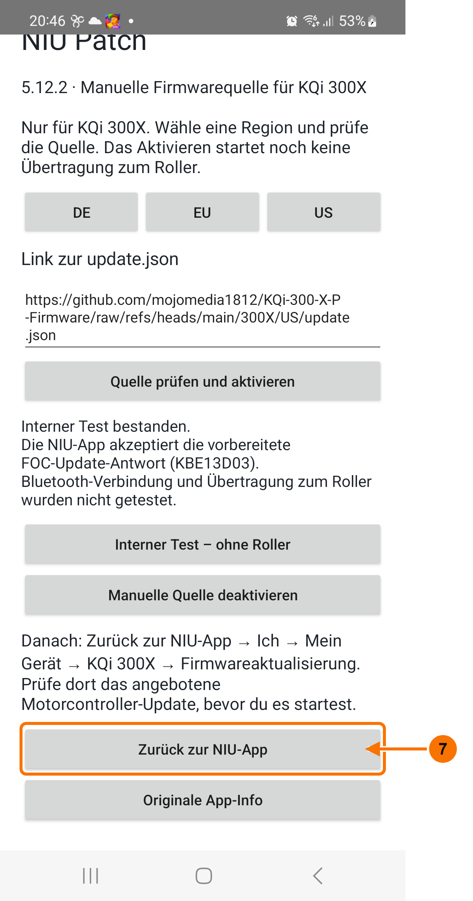

**Bild H — Zur App zurückkehren, Aktion 7.** Auf **Zurück zur NIU-App** tippen. Für dieses Bild wurde etwas nach unten gescrollt; deshalb stehen die Elemente höher als auf den vorigen Bildern. **Originale App-Info** darunter öffnet eine andere Seite. Falls anschließend die Einstellungen erscheinen, mit dem Zurück-Pfeil zum Profil wechseln.

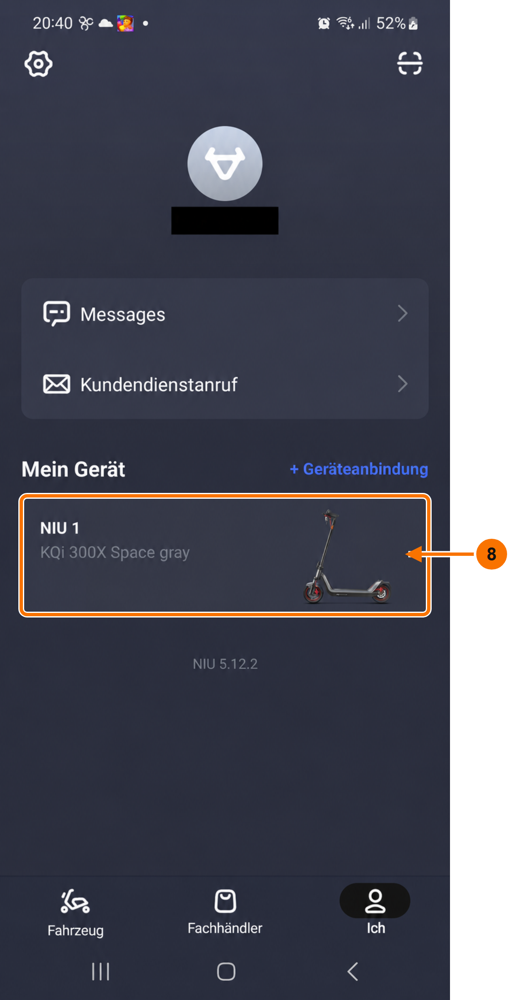

**Bild I — Vorhandenen Roller wählen, Aktion 8.** Unter **Mein Gerät** auf die Karte deines bereits gebundenen **KQi 300X** tippen. **+ Geräteanbindung** ist nicht der gewünschte Knopf. Diese Abbildung markiert ausschließlich die Fahrzeugauswahl; die Einstellungen hatten ihr eigenes Bild B.

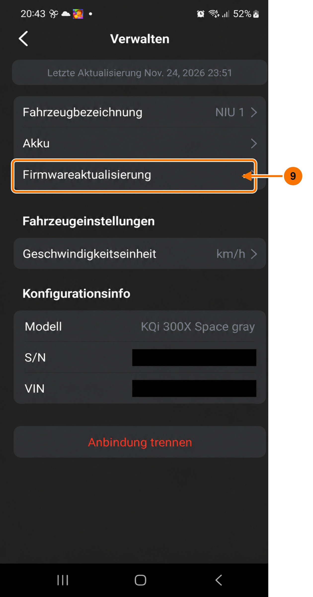

**Bild J — Firmwareprüfung öffnen, Aktion 9.** Auf **Firmwareaktualisierung** tippen. **Das ist noch nicht der Knopf zum Starten einer Übertragung.** Ohne Bluetooth-Verbindung erschien bei dieser Aufnahme nur die Verbindungsaufforderung. **S/N und VIN** unter Konfigurationsinfo wurden für die Veröffentlichung geschwärzt. Ein tatsächliches Update-Angebot muss am erreichbaren Roller zusätzlich geprüft werden.

## 7. Übertragung und Abschluss

1. Lies alle Hinweise auf der Fahrzeug-Firmwareseite und erfülle die angezeigten Bedingungen.
2. Nur nach der Angebotskontrolle: Wähle **Jetzt aktualisieren / Update now** und prüfe gegebenenfalls den folgenden Bestätigungsdialog. Ab dem Start des Update-Ablaufs ist mit einer Firmwareübertragung zu rechnen.
3. Lass NIU Patch im Vordergrund, den Bildschirm eingeschaltet und das Handy beim Roller. Schalte Bluetooth und Internet nicht ab und wechsle während einer laufenden Übertragung nicht zur originalen App.
4. Schalte den Roller nicht von Hand aus und betätige währenddessen keine Fahrzeugbedienelemente. Folge ausdrücklich angezeigten App-Anweisungen; ein vom Controller selbst ausgelöster Neustart ist davon zu unterscheiden.
5. Warte auf eine ausdrückliche Erfolgsmeldung. Ein abgeschlossener Download oder ein voller Fortschrittsbalken allein beweist keinen erfolgreichen Flash. Eine feste sichere Übertragungsdauer wurde hier nicht gemessen.
6. Nach beendetem Vorgang: Verbinde bei Aufforderung erneut, öffne die Versionsübersicht und dokumentiere die angezeigte Motorcontroller-Version. Eine zwischengespeicherte Anzeige allein ist kein unabhängiger Auslesebeweis.
7. Öffne **Profil/Ich → Einstellungen → Über → NIU Patch** und tippe **Manuelle Quelle deaktivieren**. **Nicht nach der alten Anleitung das Feld leeren und Update drücken.**
8. Kontrolliere **Manuelle Quelle: aus. Die normale Firmwareprüfung ist aktiv.** Damit ist die App-Umleitung aus; die Roller-Firmware wird dadurch nicht zurückgesetzt.
9. Schließe NIU Patch, bevor du für die normale Verwendung die originale NIU-App verbindest. Ein dort angebotenes Fahrzeug-Firmwareupdate wäre eine weitere Änderung am Roller.
10. Prüfe nach einem abgeschlossenen Update zunächst Fehleranzeige, Bremsen und Licht im Stand. Bei Warnungen oder Fehlverhalten keine Probefahrt. Einen späteren Geschwindigkeitstest nur in einem geeigneten abgesperrten Bereich durchführen.

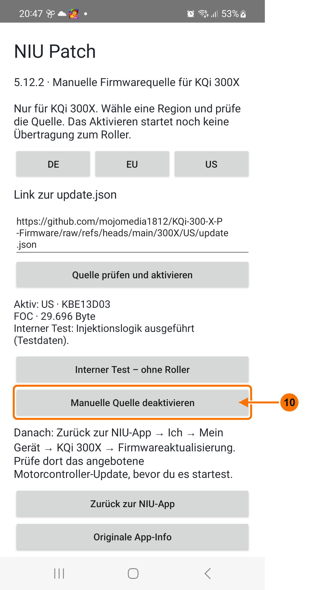

**Bild K — Quelle nach beendetem Vorgang ausschalten, Aktion 10.** Das Zusatzmenü erneut öffnen und auf **Manuelle Quelle deaktivieren** tippen. Das Bild zeigt die noch aktive Quelle nach dem internen Test. Bei einem echten Fahrzeugupdate erst nach beendetem Vorgang hierher zurückkehren. Den JSON-Link musst du nicht löschen.

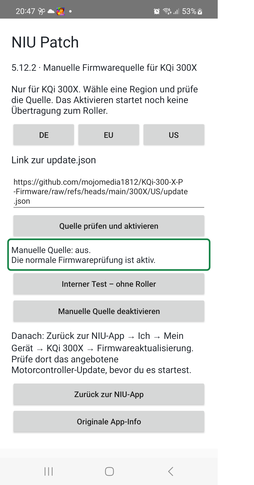

**Bild L — Ausschalten bestätigen, keine Tippaktion.** Im **grünen Rahmen** muss **Manuelle Quelle: aus. Die normale Firmwareprüfung ist aktiv.** stehen. Der JSON-Link kann weiterhin im Feld stehen; entscheidend ist dieser Status. So wurde die App nach den Aufnahmen hinterlassen. Das Deaktivieren ist keine Rückkehr zu einer anderen Roller-Firmware.

## 8. Fehlerhilfe

### Installation oder Anmeldung scheitert

- Prüfe Android-Version, ARM64-Unterstützung, vollständigen Download und die genaue Android-Meldung. Vergleiche bei Bedarf die SHA-256-Prüfsumme.
- Eine bereits installierte App mit gleicher Paketkennung und anderer Signatur kann nicht als normales Update ersetzt werden. Nicht vorschnell deinstallieren: Dabei würden ihre lokalen Daten verloren gehen.
- Nutze das bestehende Konto und die richtige Anmelderegion. Die Anmeldung der originalen NIU-App und der früheren separaten Test-App wird nicht automatisch in NIU Patch übernommen.
- Lösche nicht als Standardlösung Appdaten, Konto oder Fahrzeugbindung. Die frühere BT-Secrets-Kopierfunktion ist in diesem Release nicht vorhanden.

### Unter Über fehlt das neue Menü

1. Prüfe den geöffneten App-Namen: **NIU Patch**, nicht NIU und nicht die separate Test-App NIU Patch 5.
2. Prüfe die Version **5.12.2** und die Paketkennung `com.niu.lxckb9p` in der Android-App-Info bzw. den [Release-Daten](../apps/niu-patch/release.json).
3. Öffne die **App-Einstellungen im Profil**, anschließend **Über**. Die Android-Systemeinstellungen und die Fahrzeug-Firmwareseite sind andere Ansichten.

### Quelle lässt sich nicht aktivieren

1. Prüfe die Internetverbindung. Ein Netzwerkwechsel ist nur vor einer Übertragung sinnvoll.
2. Wähle die Region über **DE / EU / US** erneut, statt eine BIN-Adresse oder GitHub-Dateiansicht einzufügen.
3. Tippe **Quelle prüfen und aktivieren** und lies die genaue Fehlermeldung.
4. Bei einer Prüfsummenabweichung nicht umgehen oder Werte erfinden. Die App erwartet die geprüften Dateien dieses Releases. Der interne Test benötigt zuerst eine erfolgreich aktivierte Quelle.

### Kein Update-Angebot oder keine Bluetooth-Verbindung

1. Kontrolliere die aktive Quelle, gewählte Region, richtigen Roller und die tatsächliche Bluetooth-Verbindung. Schließe andere Verbindungen zum Roller.
2. Öffne die Fahrzeug-Firmwareseite nach der Aktivierung neu.
3. Prüfe, ob die gewünschte Zielversion bereits installiert ist; ein erneuter Flash wäre dann normalerweise unnötig.
4. Ein erfolgreicher interner Test beweist weder Bluetooth-Kompatibilität noch ein tatsächlich angezeigtes Angebot. Dokumentiere Android-Version, Release, Ausgangsversion, Region und genaue Meldung. Veröffentliche keine Zugangsdaten, Bluetooth-Schlüssel, Seriennummern oder VIN.
5. Ändere keine Versionsnummern oder Zeitstempel, um ein Angebot zu erzwingen. Eine universelle Umgehung für ausbleibende Angebote ist nicht nachgewiesen.

### Fehler während Download oder Übertragung

Lies die genaue Meldung und unterscheide einen Downloadfehler von einem Fehler beim Schreiben auf den Roller. Folge einer ausdrücklichen Aufforderung zum Wiederverbinden oder Wiederholen nur nach beendetem Versuch. Solange der Updatezustand unklar ist, nicht eigenmächtig ausschalten, Appdaten löschen oder eine andere Firmware nachschieben. Eine Wiederherstellung eines nicht mehr erreichbaren Controllers wurde mit diesem Release nicht geprüft.

### Zurück zur DE-Version

Das Deaktivieren der Quelle, das Löschen der APK oder das Öffnen der originalen NIU-App setzt die Roller-Firmware nicht zurück. Ein Wechsel zur DE-Datei wäre ein neuer vollständiger Firmware-Flash mit denselben Prüfungen; ein erfolgreicher Rückwechsel und ein vollständig wiederhergestellter Werkszustand sind nicht für jede Kombination nachgewiesen.

## Nachweise und ältere Anleitung

[Release und Prüfsummen](https://github.com/mojomedia1812/KQi-300-X-P-Firmware/releases/tag/niu-patch-v5.12.2-r1) · [APK-Details](niu-patch.md) · [Öffentlicher Prüfbericht](../apps/niu-patch/verification-5.12.2-r1.json) · [Quellen und Versionsabgrenzung](niu-patch-quellen.md) · [Archiv: bebilderte Anleitung 4.8.12](niu-patch-anleitung-4.8.12.md)
